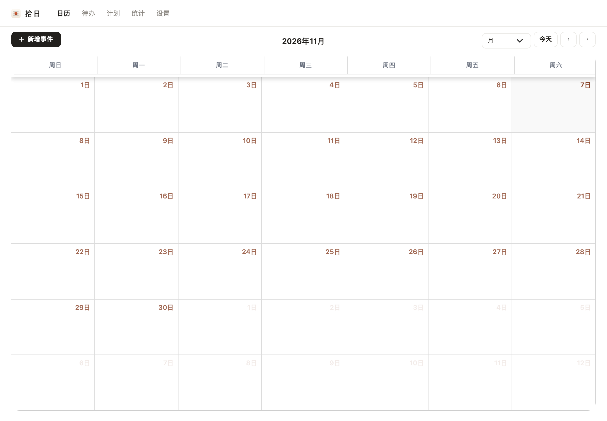
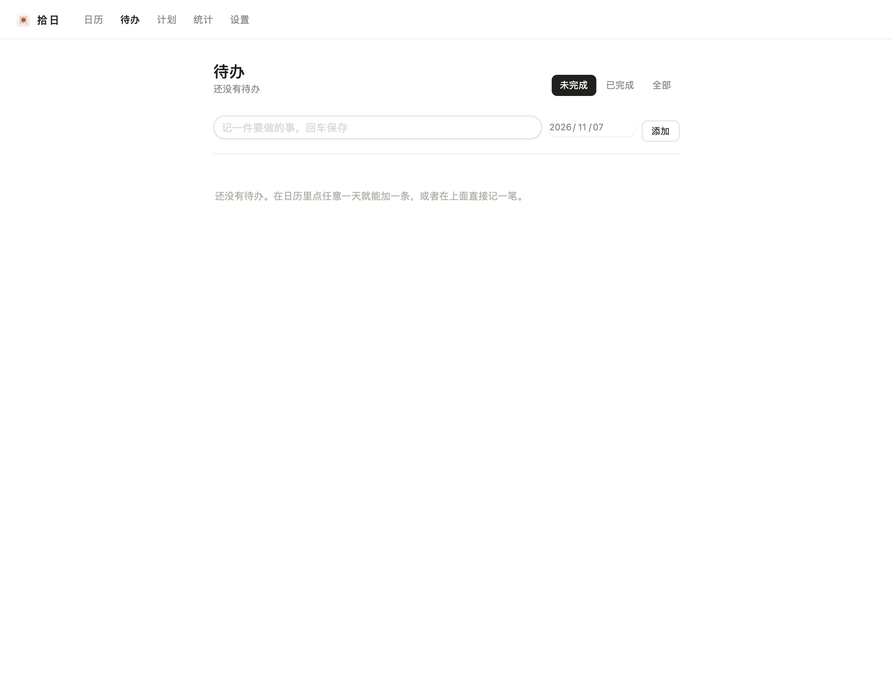
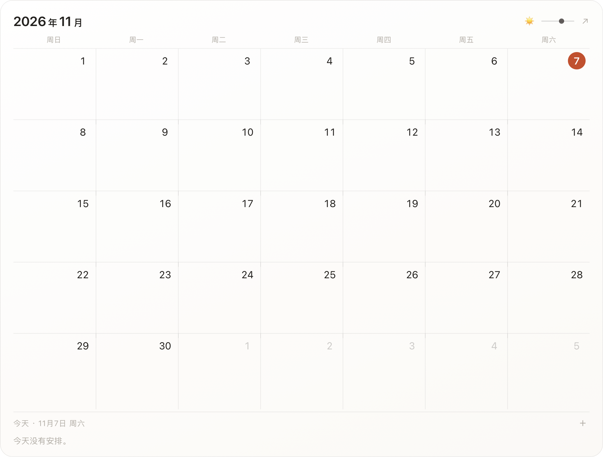
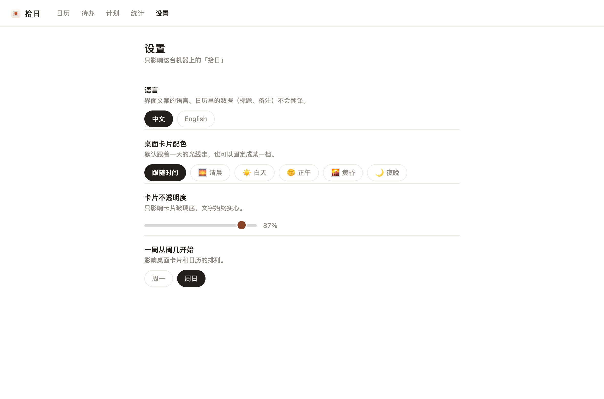

# 拾日 Shiri

一个只给自己用的本机日程应用：**日历 / 待办 / 计划 / 统计 / 设置** 五个页面，外加一张贴在桌面上的半透明月历。

它不是从零写的：后端取自一个开源的 PHP 项目管理/日历框架（AGPL-3.0，见 [`NOTICE.md`](NOTICE.md)），
我把它整体白标成 Shiri、砍到只剩日历、换掉整套界面，再用一个 Swift 的原生外壳包成 macOS 窗口。

- 打开就是日历，没有登录页、没有仪表盘、没有项目管理那一套
- 桌面浮层停在桌面图标之上、普通窗口之下；点空白处能拖，配色跟着一天的光线走（清晨 / 白天 / 正午 / 黄昏 / 夜晚）
- 待办、例行计划、统计全部复用后端的 ticket 模型，所以勾选、逾期、打点这些逻辑一行都没重写

| 日历 | 待办 |
| --- | --- |
|  |  |

| 桌面浮层 | 设置 |
| --- | --- |
|  |  |

## 仓库里有什么

```
app/
  app/                     PHP 后端源码（Shiri\ 命名空间，含本项目全部改动）
  public/dist/css|js|img/  前端只保留本项目写过的那几个文件
runtime/
  desktop/main.swift       macOS 原生外壳（WKWebView + 桌面浮层）
  desktop/build.sh         编译打包成 拾日.app
  desktop/make-icon.py     App 图标生成器
  nginx.conf php-fpm.conf  本机服务配置（只监听回环）
  start.sh stop.sh         手动启停
  install-autostart.sh     注册开机自启（launchd，local.shiri.*）
  launchagents/            launchd plist 模板
  README.md                实现细节：坑、取舍、数据口径（这篇才是主文档）
```

**不在仓库里**（体积大 / 有凭据 / 可重新生成）：

| 排除了什么 | 怎么补回来 |
| --- | --- |
| `app/vendor/`（183 MB） | `composer install --no-dev` |
| `app/public/assets`、`public/dist` 的上游产物（75 MB） | 用官方 3.13.2 包覆盖 |
| `app/config/.env` | 照着 `config/sample.env` 改，见下 |
| `storage/`、`userfiles/`、`logs/`、`runtime/tmp/` | 运行时自动生成 |

## 自己跑起来

```bash
# 1. 拿一份干净的上游发行包，铺进 app/
#    只补缺失文件（--ignore-existing），不会覆盖本项目改过的文件
bash tools/restore.sh /path/to/上游发行包.tar.gz
#    铺完必须再跑一次白标，把上游的品牌标识换回 shiri（旧品牌名自己传）
python3 tools/whitelabel.py --from <旧品牌名>

# 2. 填数据库配置
cp app/config/sample.env app/config/.env
#    LEAN_DB_HOST / LEAN_DB_USER / LEAN_DB_PASSWORD / LEAN_DB_DATABASE

# 3. 依赖与库表
cd app && composer install --no-dev
#    浏览器打开一次完成建库，或导入官方 schema

# 4. 起服务
bash runtime/start.sh
#    默认 http://localhost:8080

# 5. （可选）打包成原生 App
bash runtime/desktop/build.sh
```

自定义表（`zp_recurring`、`zp_recurring_log`、`zp_rb_prefs`）由代码 `CREATE TABLE IF NOT EXISTS` 自建，
不需要额外导入。

## 实现上值得一提的几处

- **后端一行没改**：日历、待办、计划、统计共用 `app/Domain/Calendar/Support/TodoBoard.php` 一份取数逻辑，
  页面控制器只做参数搬运
- **例行计划**不依赖 cron：打开任意待办相关页面时补生成「未来 21 天」，靠 `zp_recurring_log(ruleId, dateKey)`
  唯一键防重
- **语言是两层**：改过的模板走自写的 `Support/Lang.php` 字典，日历页/弹层仍走框架的 `__()`；
  渲染前用 `Lang::applyToShiri()` 把两边对齐，否则会出现「导航英文、日历中文」
- **浮层与主窗口是两个 webview**：设置改完，浮层每 30 秒比对一次服务端偏好，不一致就整页重载
- 详细的坑与取舍都写在 [`runtime/README.md`](runtime/README.md)：
  桌面层级与非激活面板、窗口坐标迁移、CSS 变量写在哪一层、图标在 32pt 下的取舍……

## 许可

`app/` 的后端派生自一个 AGPL-3.0 许可的开源框架（署名与出处见 [`NOTICE.md`](NOTICE.md)），
原许可文本随发行包分发时一并保留。本项目自己写的部分（原生外壳、前端、图标、白标脚本）随同上机自用，未另设许可。
