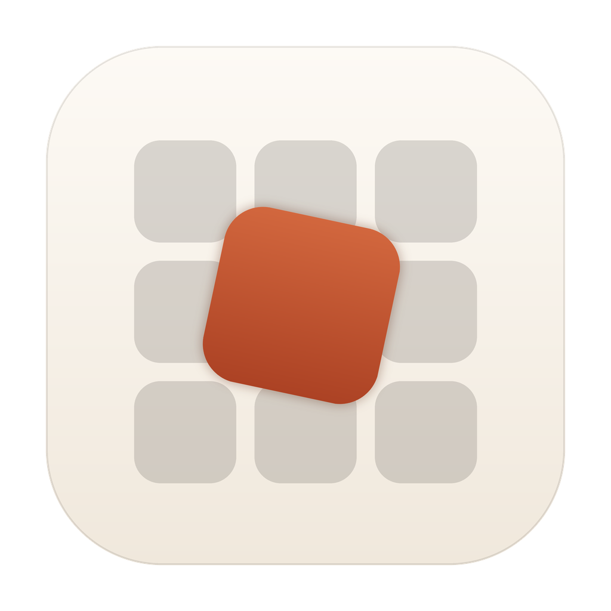
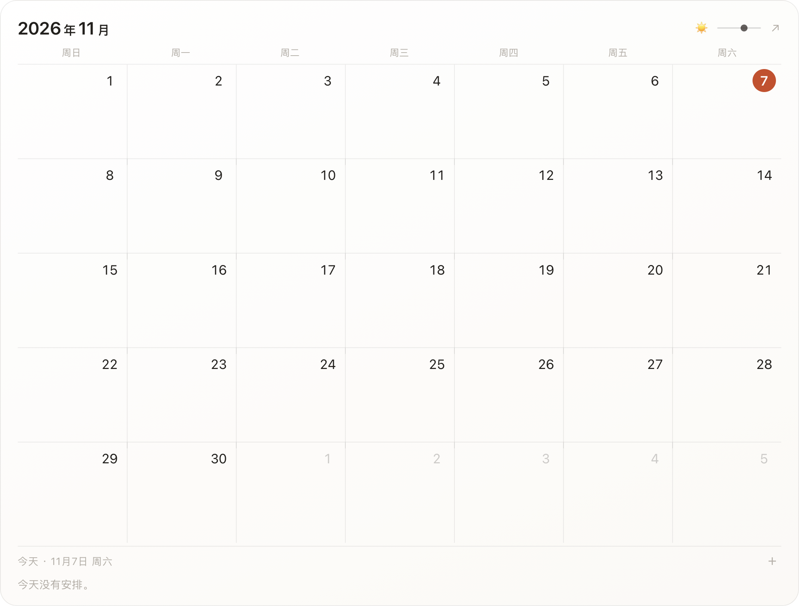
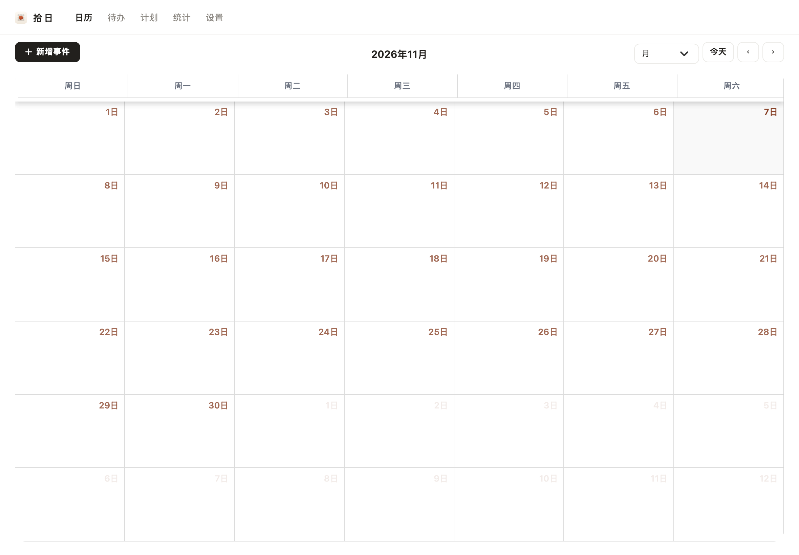
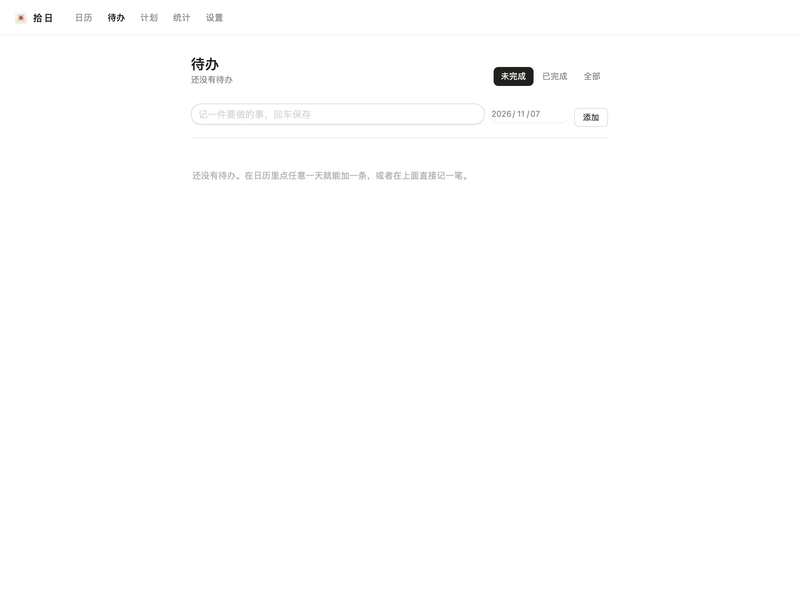
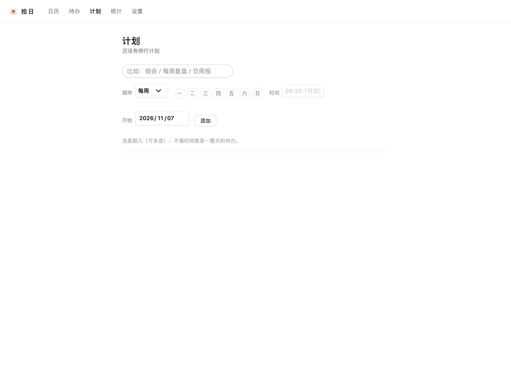
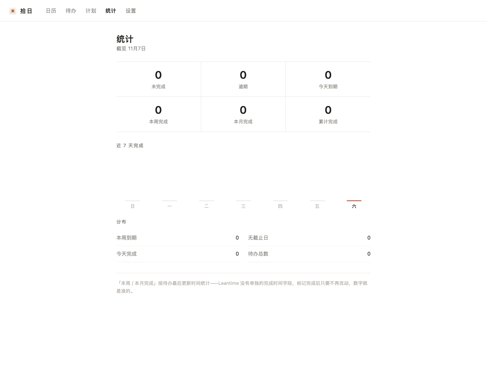

<div align="center">



# 拾日 Shiri

**一张贴在桌面上的月历，和它背后完整的一套日程。**

[English](README.md) | [**中文**](README_CN.md)

[](https://github.com/CarlYuHQ/Shiri/stargazers)
[](NOTICE.md)
[](runtime/desktop/main.swift)
[](https://www.php.net/)

</div>

---

日历应用现在都太重了：登录页、仪表盘、项目管理、协作邀请——我只是想看一眼这个月有什么安排。拾日反着来：打开就是日历，没有多余的一屏；再把一张半透明的月历直接贴在桌面上，壁纸旁边，扫一眼就有。

- **五个页面**：日历 / 待办 / 计划 / 统计 / 设置，待办、例行计划、统计共用同一份取数逻辑，勾选、逾期、打点这些逻辑一行都没重写
- **桌面浮层**：停在桌面图标之上、普通窗口之下；点空白处能拖，配色跟着一天的光线走（清晨 / 白天 / 正午 / 黄昏 / 夜晚）
- **原生外壳**：Swift + WKWebView 包成 macOS 窗口，程序化构建图标，launchd 管理本机服务（nginx / php-fpm / MariaDB，只监听回环）

<div align="center">
  
</div>

## 页面一览

|  | 页面 | 说明 |
|--|------|------|
| **日历** | 打开就是日历 | 月视图 + 事件弹层，toolbar 上的新增、今天、翻月都是定制的 |
| **待办** | 勾选即完成 | 按天分组的清单，悬停出 ×、右键也能删，逾期自动标红 |
| **计划** | 例行任务不靠 cron | 打开页面时补生成「未来 21 天」，唯一键防重，漏一天都会补上 |
| **统计** | 一眼看出节奏 | 完成量、逾期、连续打卡，按待办最后更新时间统计 |
| **设置** | 全部可调 | 界面语言（中文 / English）、时段主题、卡片不透明度、周起始 |
| **重要节点** | 日历右侧一栏 | 重要时间节点与遥远未来，按「还有多少天」倒计时，近期 / 遥远 / 已过去分组 |
| **桌面浮层** | 壁纸旁边的月历 | 半透明卡片，透明度滑杆实时生效；设置改完 30 秒内自动同步 |

| 日历 | 待办 |
| --- | --- |
|  |  |
| **计划** | **统计** |
|  |  |

## 快速开始

这套东西是给自己用的，部署在单机上：clone 之后铺一层上游发行包、填数据库、起服务。

```bash
# 1. 拿一份干净的上游发行包，铺进 app/
#    只补缺失文件（--ignore-existing），不会覆盖本项目改过的文件
bash tools/restore.sh /path/to/上游发行包.tar.gz
#    铺完必须再跑一次白标，把上游的品牌标识换回 shiri（旧品牌名自己传）
python3 tools/whitelabel.py --from <旧品牌名>

# 2. 填数据库配置
cp app/config/sample.env app/config/.env
#    LEAN_DB_HOST / LEAN_DB_USER / LEAN_DB_PASSWORD / LEAN_DB_DATABASE

# 3. 依赖与库表
cd app && composer install --no-dev
#    浏览器打开一次完成建库，或导入官方 schema

# 4. 起服务
bash runtime/start.sh          # 默认 http://localhost:8080

# 5. （可选）注册开机自启 + 打包原生 App
bash runtime/install-autostart.sh
bash runtime/desktop/build.sh
```

自定义表（`zp_recurring`、`zp_recurring_log`、`zp_rb_prefs`）由代码 `CREATE TABLE IF NOT EXISTS` 自建，不需要额外导入。

**不在仓库里**（体积大 / 有凭据 / 可重新生成）：

| 排除了什么 | 怎么补回来 |
| --- | --- |
| `app/vendor/`（183 MB） | `composer install --no-dev` |
| `app/public/assets`、`public/dist` 的上游产物（75 MB） | 用官方 3.13.2 包覆盖 |
| `app/config/.env` | 照着 `app/config/sample.env` 改，见上 |
| `storage/`、`userfiles/`、`logs/`、`runtime/tmp/` | 运行时自动生成 |

## 项目结构

```
app/
  app/                     PHP 后端源码（Shiri\ 命名空间，含本项目全部改动）
  public/dist/css|js|img/  前端只保留本项目写过的那几个文件
runtime/
  desktop/main.swift       macOS 原生外壳（WKWebView + 桌面浮层）
  desktop/build.sh         编译打包成 拾日.app
  desktop/make-icon.py     App 图标生成器
  nginx.conf php-fpm.conf  本机服务配置（只监听回环）
  start.sh stop.sh         手动启停
  install-autostart.sh     注册开机自启（launchd，local.shiri.*）
  launchagents/            launchd plist 模板
  README.md                实现细节：坑、取舍、数据口径（这篇才是主文档）
tools/
  restore.sh               铺上游发行包
  whitelabel.py            品牌白标替换（--from <旧品牌名>）
```

## 实现上值得一提的几处

- **后端一行没改**：日历、待办、计划、统计共用 `app/Domain/Calendar/Support/TodoBoard.php` 一份取数逻辑，页面控制器只做参数搬运
- **语言是两层**：改过的模板走自写的 `Support/Lang.php` 字典，日历页/弹层仍走框架的 `__()`；渲染前用 `Lang::applyToShiri()` 把两边对齐，否则会出现「导航英文、日历中文」
- **浮层与主窗口是两个 webview**：设置改完，浮层每 30 秒比对一次服务端偏好，不一致就整页重载
- **白标是可重放的**：PHP 命名空间、类名、RPC 前缀、JS 全局、数据库账号全部换名，且写成幂等脚本——升级上游后重跑一遍即可

更详细的坑与取舍（桌面层级与非激活面板、窗口坐标迁移、CSS 变量写在哪一层、图标在 32pt 下的取舍……）见 [`runtime/README.md`](runtime/README.md)。

## 许可

`app/` 的后端派生自一个 AGPL-3.0 许可的开源框架（署名与出处见 [`NOTICE.md`](NOTICE.md)），原许可文本随发行包分发时一并保留。本项目自己写的部分（原生外壳、前端、图标、白标脚本）随同上机自用，未另设许可。
